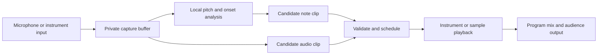

# AILANG live loop instrument

**Status:** Long-term design, 2026-10-23. Prototype host soak passed; the user reports
the microphone workflow working. Next priorities: [musical roadmap](live-loop-musical-roadmap.md)
(auto-levels/recovery → hum-to-bass → instrument palette/effects). Broader hardware
and physical latency acceptance remains separate.
**Product direction:** An original live pattern instrument with private humming and instrument capture, keyboard and musical-controller operation, and optional AI-directed development.
**Related work:** [First class audio support roadmap](first-class-audio-roadmap.md).

Select the bass track, hold a capture key or pedal, and hum a melody. On release, the detected notes become a bass phrase scheduled for an upcoming loop boundary. Continue playing while another part is captured, replace or overdub a take, and undo without stopping the session. The target is audible entry within ten seconds after the take ends under a declared performance configuration.

AILANG owns musical state, patterns, validation and accepted edits. A host owns capture and the audio clock. This follows the separation discussed for Stapledon's Voyage and Godot: domain decisions pass through an explicit interface to a host that delivers the sensory output. Cloud model inference is optional and never required for the basic capture-to-loop handoff.

## Repository placement

This repository can house the design and initial application as well as reusable packages. Its existing `design_docs/` and `examples/` directories provide the appropriate distinction. Proposed implementation locations are:

| Location | Responsibility |
|---|---|
| `packages/audio/` | Clips, channel handling, DSP, measurement, sample conversion and bounded processing |
| `packages/music-patterns/` | Proposed registry identity `sunholo/music_patterns`: musical time, notes, pattern queries and deterministic transformations |
| `examples/live-loop/` | Performance application, session state, controller profiles, browser host and integration tests |
| AILANG core and stdlib | Shared binary/audio primitives and measured runtime or host gaps, coordinated with the existing core work |

The new package name and directories are proposals, not existing APIs. Keep application-specific track layouts and controller assignments in the example until reuse justifies extraction. The application can move to its own repository later without moving its reusable packages. This design creates no dependency on Strudel; the initial implementation has its own musical semantics and interface.

## Product requirements

The first instrument supports four parts: drums, bass, harmony and texture. Each track has an instrument, level, pan, mute/solo, an active phrase and a pending revision. The selected track provides the target for capture and editing.

| Interaction | Required result |
|---|---|
| Select Bass, hold capture, hum, release | A monophonic melody preview becomes notes played by the bass instrument on a declared boundary |
| Select a track and capture instrument audio | A bounded recording becomes an audio loop, with explicit trim/pad and seam treatment |
| Play a MIDI instrument | Note events and supported expression are recorded against the same musical transport |
| Press a keyboard key, pad or pedal | Arm, capture, overdub, replace, mute, cancel or undo the selected track |
| Insert a break on beat three | An explicit edit suppresses the selected track's events over a defined beat range |
| Schedule a key change after two beats | A change with a specified destination key or transposition applies at a visible musical position |
| Ask for musical development | An optional AI proposal becomes the same validated command type used by manual editing |

Voice commands are a later interface to those commands. Keyboard/controller operation and local melodic capture are sufficient for the first usable version. Ambiguous instructions such as an unspecified destination key remain proposals until the missing value is supplied; the running session continues.

Initial scope includes local session save/load, undo/redo, seeded variation and a basic instrument set using synthesis and project-owned samples. Live instrument monitoring and audience output need explicit routing. Polyphonic audio-to-note transcription, general plugin hosting, full score editing, external clock synchronization and a complete DAW are subsequent work.

## Performance workflow

1. Configure tempo, meter and phrase length, with a four-bar 4/4 phrase at 120 BPM as the reference configuration.
2. Select a track and choose **Notes** or **Audio** capture. Capture mode is always visible.
3. Press the bound capture control. Record immediately into a private buffer and show its position relative to the loop. A separate count-in option can arm a capture for a future bar.
4. Track pitch/onsets or audio frames incrementally while the performer plays. Show provisional notes, input level and remaining capture capacity.
5. Release the control, or reach the configured capture limit. Finalize the candidate and show its intended start boundary.
6. Validate the candidate and schedule an atomic revision. The UI distinguishes Proposed, Ready, Scheduled and Active states.
7. At the acknowledged boundary, switch that track's revision. Other tracks keep playing. Undo schedules the preceding revision through the same mechanism.

The immediate-capture origin is the first recorded frame. Captured offsets are relative to that origin, and the resulting clip begins at its scheduled phrase boundary. This makes a melody captured mid-loop start at the beginning of its new phrase. Preserving the old transport phase can be an explicit later capture option.

The user selects Replace or Overdub before capture. Replace substitutes the selected part; Overdub merges note events or layers audio subject to event, voice and headroom limits. No capture silently deletes an active phrase. A lost release event, controller disconnect or UI focus loss closes/cancels capture through the host lifecycle rather than leaving recording unbounded.

## Capture and privacy



In **Notes** mode, local processing produces pitch, onset, duration, confidence and an amplitude-derived expression estimate. The chosen instrument plays the resulting notes. In **Audio** mode, the performer deliberately commits the recording itself. MIDI capture supplies note/controller events directly; MIDI is a control protocol, not an audio recording. [Web MIDI specification](https://www.w3.org/TR/webmidi/)

Raw microphone audio has no default route to the master bus, audience stream, project export, diagnostic log or external model. Note capture does not implicitly retain the raw take as a saved asset. Retaining raw takes or submitting audio for external analysis requires a separate explicit option; changing a capture mode cannot retroactively publish a previous take. Bounded transient buffers are released when their job is complete or cancelled; this is a retention policy, not a claim of secure memory erasure.

Private cue monitoring is off by default. A software cue bus alone does not provide acoustic privacy: headphones or an independently routed output are needed when the master output is audible to an audience. A controller command to monitor input must not connect it to the program bus implicitly. Audio mode explicitly marks that the committed recording will enter the program mix.

Monophonic humming and single-note instruments are the first transcription targets. Pitch-range presets, octave assignment into the selected instrument's range, minimum note length, onset splitting, confidence thresholds and optional pitch bends must be explicit and versioned. Timing quantization, scale snapping and pitch correction are adjustable; preserve the detected phrase as a reversible source representation. Low-confidence material remains visible for correction or cancellation rather than generating arbitrary notes or publishing the raw voice as a fallback.

## Musical model and pattern queries

Use a pure query interface with the conceptual shape:

```text
pattern + seed + half-open musical interval -> bounded events
```

A pattern describes events independently of the scheduler's query size. Sequences, parallel parts, repetition, rests, shifts, transposition and seeded variation form the initial vocabulary. Strudel demonstrates this general interval-query model; it is a useful reference for the separation between musical patterns and their output host. [Pattern model reference](https://strudel.cc/technical-manual/patterns/)

The implementation should use validated integer musical ticks for the first bounded vocabulary: 960 ticks per quarter note, integer tempo in a declared range, and an explicit meter/phrase length. Triplets and common straight subdivisions fit this grid; arbitrary rational tuplets are a later extension with their own overflow and normalization rules. Store tempo changes as a timeline and convert ticks to audio frames using one documented rounding policy. Do not accumulate a rounded frame duration once per beat and allow drift to grow.

Each event has stable identity, track, origin revision, musical onset, duration and typed payload. Random choices derive from the session seed and stable event/cycle identity, not from query count or mutable RNG consumption. Querying the same region in smaller pieces must preserve the resulting performance.

Separate events that **start** in an interval from voices that remain **active** across it. Use half-open onset ownership, stable event IDs and an explicit active-voice policy so a sustained note is not retriggered at every query boundary. A scheduled key change affects future onsets by default; held notes keep their existing pitch until note-off. Retuning held voices can be an explicit future operation.

The visual editor and a compact text notation both construct a typed pattern tree. Parse text into that tree using a bounded grammar. Do not evaluate generated JavaScript or arbitrary source text as a performance command. Live playback and offline export should share event semantics; matching event streams do not by themselves imply identical audio samples from different synthesis backends.

## Host and AILANG responsibilities

| Component | Owns |
|---|---|
| Pure AILANG modules | Pattern queries, session transitions, controller-command interpretation, validation, revision planning and replay |
| Local analysis worker | Incremental pitch/onset analysis and candidate construction with bounded buffers; implementations can begin as reference DSP and move to measured kernels |
| Audio host | Input devices, frame timestamps, audio clock, scheduling, voice lifecycle, routing, monitoring and underrun reporting |
| Application UI | Selection, capture state, note/waveform preview, mapping editor, countdown, levels and errors |
| Optional AI adapter | Structured musical proposals with explicit request/cost budgets, independent of playback deadlines |

The proposed first host is a browser application using Web Audio and microphone capture, with MIDI support tested against a declared browser/device configuration. Web Audio provides a host-side audio graph and processing interfaces; Media Capture provides access to local audio input. These are host facilities, not APIs already supplied by `sunholo/audio`. [Web Audio Recommendation](https://www.w3.org/TR/2021/REC-webaudio-20210617/), [Media Capture specification](https://www.w3.org/TR/mediacapture-streams/)

Use an AudioWorklet or equivalent host audio path for bounded capture and playback work. Keep UI work, model calls, file access and unbounded allocation away from that path. Exchange bounded blocks or asset handles with workers; avoid sending or copying an entire growing recording on every input block. Initial deployment can use an AILANG worker/WASM bridge if measured performance is sufficient; a local AILANG process is an alternative transport adapter, not a different musical model. Settle that implementation choice in the host feasibility milestone.

Do not claim realtime execution guarantees for the AILANG VM. Native DSP or host kernels may be necessary, but introducing a new language feature requires a reproduced gap and a separate core proposal. The inspected v0.54.17 `std/audio` surface exposes file-oriented WAV and Opus operations, not capture, device playback or a sample clock. Recheck capabilities against the other agent's core updates before implementation.

## Protocol and revision lifecycle

Commands are schema-versioned data. Suggested command families are SelectTrack, BeginCapture, EndCapture, CancelCapture, ReplaceClip, OverdubClip, SetParameter, InsertBreak, Transpose, SetKey, Undo and Redo. Keyboard controls, MIDI mappings, visual edits and optional language interpretation all enter through this common boundary.

Every mutating command carries a command ID, expected session/track revision, target track and intended musical position where relevant. BeginCapture binds the target track, instrument and mode at capture start; selecting another track during capture does not redirect the take. Store controller profiles using stable logical actions rather than hard-coded UI coordinates. Key auto-repeat and repeated MIDI messages must not create duplicate captures or commits.

A prepared playback revision includes:

- Session, track, base revision, new revision and originating command IDs.
- Effective musical boundary and corresponding host audio-frame position.
- Pattern/assets with hashes and sample-rate/channel metadata.
- Voice/event/resource limits and the transition policy for held notes and effect tails.
- A readiness deadline and the target transport epoch.

The host acknowledges Prepared and then Scheduled only when it has the required assets and can meet the requested boundary. Active is reported from the applied audio timeline, not optimistically from a UI click. Stale acknowledgements cannot overwrite newer state. Duplicate messages are idempotent. Transport stop/seek, device reset and a new session increment the epoch and invalidate obsolete scheduled work.

If a take is not ready by the staging deadline, continue the current revision and show the next eligible boundary or an explicit failure. Never stop the musical clock to wait for a model, route uncommitted input to master, or replay every missed event after recovery. Cancel and Undo before activation must have documented behavior; after the host commit deadline, Undo schedules a compensating revision rather than pretending an already queued change was cancelled.

## Timing target

**Target:** audible entry within 10 seconds of capture completion or an edit command under the declared reference configuration. The capture duration itself is separate from that interval. Measure the audible result, not just a worker finishing or a scheduling acknowledgement.

At 120 BPM, a four-bar phrase in 4/4 lasts eight seconds. Let `t_end` be capture completion, `t_ready` the time a validated candidate and its assets are available, `g` the host staging margin, and `b` the selected boundary:

```text
b = first eligible boundary at or after t_ready + g
handoff delay = audible onset - t_end
```

An initial engineering budget is p95 candidate preparation <=500 ms and a 200 ms staging margin. With eight-second boundaries, the scheduling component can then fit within approximately 8.7 seconds; actual output latency, clock conversion and missed deadlines still have to be measured. These are proposed targets, not benchmark results or hard realtime guarantees. If the last captured sample arrives after a boundary's commit deadline, it cannot be included retrospectively at that boundary.

Loop lengths and tempo can make a ten-second phrase-boundary target impossible. The UI must show this and offer next-bar or another explicit entry quantization; do not silently change quantization. A long expressive take may also need larger capture limits. Distinguish the first chronological boundary from the first boundary the host can actually commit safely.

Capture and controller timestamps must be mapped into the host audio clock, accounting for input/output latency and measured device offset. Instrument monitoring latency is a separate metric from capture-to-loop turnaround. Tempo changes during capture use a versioned tempo map; changing the tempo cannot silently reinterpret recorded frame offsets.

## Controllers and performance interface

Provide a mapping editor with keyboard bindings and MIDI learn. Profiles include device/channel filters, note/button/CC bindings, momentary versus toggle behavior, absolute versus relative knobs, value curves and parameter bounds. Map pedals to capture or overdub; map pads to track selection, mute or scenes; map knobs to declared instrument parameters. Reserved transport actions need a deliberate binding, not incidental note input.

Learn mode consumes the binding gesture without also performing its musical action. Distinguish performance input from control mappings and prevent feedback when input/output use the same MIDI device. On disconnect, finish/cancel capture and release owned notes. Suppress global keyboard actions while typing in a text field; handle focus loss and stuck sustain/note state explicitly. Persist profiles locally with editable human-readable action names.

The performance UI should show four track lanes, a clear selected track, instrument/mode, private input meter, active and pending phrase, capture countdown, entry boundary and undo state. Expose pitch/quantization correction without requiring a piano-roll editor for the basic workflow. A text pattern pane is optional during performance. Technical revision IDs and host diagnostics belong in an inspection view.

## Optional AI development

Once direct capture is dependable, AI can propose bass accompaniment, harmonic responses, rhythmic variations, sound choices and multi-phrase developments. It consumes selected musical state or explicitly authorized input and returns bounded typed edits. Validate instrument references, event density, note range, gain, duration and allowed structural changes before staging.

Proposals carry a base revision and expiry. A late proposal is discarded or offered for a later boundary; it cannot overwrite an intervening human edit. Automatic application is an explicit per-session option with a declared scope; otherwise the performer accepts proposals. Record accepted edits, seed and asset versions for replay. Runtime networking and model budgets belong in the AI adapter; pure pattern and session modules remain effect-free.

## Trust and resource limits

| Mechanism | Target guarantee | Required evidence |
|---|---|---|
| Typed commands and runtime guards | Valid tracks, time ranges, finite parameters, supported formats, consistent revisions and explicit input routing | Negative and boundary tests in ordinary runs, without optional contract flags |
| Contracts and Z3 | Checked tick/frame arithmetic, bounds, revision transitions and simple timing invariants where encodable | Actual proved/skipped/refuted/error outcomes, numeric model and recursive bounds |
| Native tests and properties | Query partition consistency, deterministic seeds, no duplicate onset ownership, idempotent commands and replay equivalence | Constrained generators and independent reference cases; report skips |
| Host integration tests | Actual boundary application, private-bus isolation, cleanup, clock mapping and audible onset | Audio loopback capture and recorded host/device configuration |
| Explicit resource limits | Bounded capture bytes, frames, analysis windows, event count, voices, worker backlog and stored assets | Oversize/flood tests and latency/memory measurements |
| Capabilities and budgets | Controlled file, network and AI operations in adapters | Effect declarations and enforced budgets, separate from DSP allocation limits |

Pure processing does not make audio-device access available. No new Audio capability is assumed; choose an effect/host interface through the core design process if needed. Mathematical proofs do not establish IEEE floating-point behavior, hardware timing, pitch-transcription quality or acoustic privacy. Keep those acceptance tests separate.

## Acceptance tests

1. **Hum to Bass:** select Bass, capture a known monophonic phrase, release, and hear the selected instrument enter on its acknowledged boundary. Assess pitch/onset quality on a versioned corpus including humming, vibrato, silence and noise, using declared tolerances.
2. **Private capture:** with an otherwise silent master, input voice while armed in Notes mode. The master/audience/export recordings remain silent until committed synthesized notes begin. Debug logs and optional network paths contain no raw take. Repeat with cue monitoring disabled and with a separately configured cue output.
3. **Audio and MIDI:** record a simple instrument loop in Audio mode and note events in MIDI mode. Verify timing, expression policy, clip length and that mode selection determines whether recorded audio is published.
4. **Turnaround:** test stop times just before and after each commit deadline, with four tracks active and incremental analysis running. Collect at least 100 handoffs; report p50/p95/p99/max capture-to-audible delays, boundary errors and misses of the ten-second target. Include near-silent input whose first audible onset is delayed; use a separate onset-at-zero fixture for clock measurements.
5. **Continuous playback:** repeat capture/overdub/replace/undo cycles during a 30-minute session. Record dropouts, drift, buffer underruns, stale activations and memory growth. A failure does not count as a passing timing result because the UI remained responsive.
6. **Pattern consistency:** compare whole-interval event queries with randomized partitions, notes crossing boundaries and simultaneous edits. Compare event identity and timing before testing rendered audio.
7. **Musical edits:** insert a one-beat break beginning at beat three and a key/transposition event two beats after an explicitly named origin. Verify exact scope, subsequent note behavior and held-note policy.
8. **Controller lifecycle:** test repeated keydown, missing keyup, focus change, pedal sustain, disconnect/reconnect, learn mode and profile reload. Capture and notes terminate predictably without a transport restart.
9. **Revision protocol:** inject duplicate, delayed and reordered commands/acks; undo before/after the staging deadline; stop/seek during preparation; exhaust queues. No stale revision becomes active.
10. **Recovery and evidence:** save/reload a session and replay accepted commands with pinned assets/seeds. Export the corresponding event timeline and mix metadata. Publish latency configuration and failure results alongside any claimed supported setup.

The reference test setup must name browser/version, OS, audio interface, input/output devices, actual sample rate, channel layout and measured latency settings. Add a second supported setup before making portability claims. Browser/API availability is checked at startup; unsupported features produce explicit errors rather than pretending controller or capture support exists.

## Delivery milestones

| Milestone | Deliverable | Exit condition |
|---|---|---|
| L0 Host feasibility | Four-part playback, private capture, audio-clock mapping and a minimal AILANG bridge | Loopback establishes scheduling accuracy, routing isolation and runtime/worker costs on the reference setup |
| L1 Direct loop capture | Track selection, Audio mode, keyboard capture, replace/overdub/undo and local save | The instrument is usable without language-model access and passes lifecycle/deadline tests |
| L2 Hum to instrument | Monophonic incremental analysis, note preview, correction and instrument playback | Hum-to-Bass and the declared ten-second target pass on the reference corpus/setup |
| L3 Patterns and controllers | Reusable pattern queries, musical edits, MIDI input, learn and saved profiles | Query/replay properties and physical controller tests pass |
| L4 AI development | Bounded musical proposals, expiry, revision conflict handling and optional acceptance | Human edits retain priority and late AI work cannot disrupt playback |
| L5 Broader instrument | More effects, recording workflows, exports and additional hosts | Each feature has independent conformance, performance and compatibility evidence |

Stereo clips, bounded block processing and stateful DSP from the audio roadmap support these milestones. Feasibility may use a host-side reference implementation of pitch tracking while package versions mature; document that placement and test equivalence before moving processing. Existing core updates remain a separate workstream. Record concrete newly reproduced core gaps for that workstream rather than inventing language features in this application.

## Decisions to settle during feasibility

- Reference browser/OS/audio interface, the actual input instrument/controller, and cue-output arrangement.
- Worker/WASM versus local-process AILANG bridge, selected by measurements and deployment needs.
- Initial pitch tracker, supported pitch range and corpus tolerances; confidence and correction defaults.
- Maximum capture duration, voices, event density, analysis backlog and project-storage budget.
- Whether the first release uses only synthesized instruments or also bundled, appropriately licensed samples.

The product direction, private capture model and controller-first interaction are established. These feasibility decisions refine implementation and performance claims without making voice interpretation or a full DAW a prerequisite.
